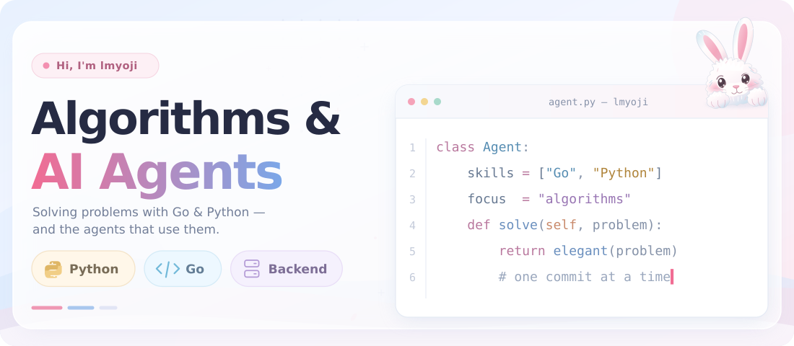

## What I work on

- **AI agent systems** · tool calling, orchestration, memory, evaluation, and dependable workflows
- **Algorithms** · data structures, optimization, search, and turning hard problems into clear solutions
- **Backend engineering** · concurrent Go services, Python automation, APIs, and integrations

## Current focus

- Designing agent runtimes that are easy to inspect, test, and extend
- Building practical algorithm implementations and performance-minded services
- Connecting Go backends with Python tooling and automation

## Principles

> solve clearly · build reliably · keep learning

